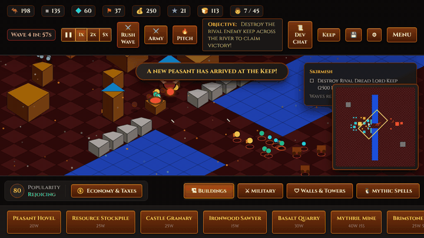

# Citadel of Legends: Shattered Realms

> **Tactical medieval castle-builder & real-time siege warfare — free, in your browser, no install.**
> An independent game inspired by the classic castle-sim genre.




---

## 🏰 Overview

Raise a living medieval citadel where every peasant is a worker, a taxpayer and a mouth to feed. Balance rations, taxes and popularity to grow your population, then defend your walls with watchtowers, boiling pitch, catapults and dragons. Three asymmetric kingdoms, a nine-mission story campaign and custom skirmishes — all drawn on HTML5 Canvas and scored by a procedural Web Audio synthesizer.

### Features
* **Three asymmetric factions** — Solaris Order (healing Paladins, tax & food bonuses), Frostbound Covenant (stone economy, Valkyries), Obsidian Scourge (stealth Bloodknights, pitch, faster armies) — each with its own monument and dragon.
* **Nine-mission campaign** with briefings, live objective tracker, bonus challenges and persistent unlocks.
* **Deep castle economy** — seven resources, rations, taxes, famine, popularity-driven immigration.
* **Real-time siege warfare** — A* armies that breach walls, watchtowers, pitch cauldrons, parabolic catapult fire with splash damage, burning dragon breath.
* **Fog of war & radar minimap** with click/drag navigation.
* **Save anywhere** — 3 slots, auto-save, export/import `.citadelsave` files.
* **Accessible & mobile-ready** — rebindable keys, high-contrast mode, reduced motion, pinch-zoom, long-press commands, virtual joystick; 0x/1x/2x/5x speed.
* **Zero runtime dependencies** — no engine, framework, CDN or tracking. ~355 KB web build. Installable PWA; Windows/macOS/Linux desktop builds.

---

## 🎮 Play

```bash
# Any static server works (service worker & saves need http://, not file://)
python3 -m http.server 8080      # or: npm run serve
# open http://localhost:8080
```

| Control | Action |
| :--- | :--- |
| Left-click / tap | Build with the selected tool, or select |
| Right-click / long-press | Move or attack with selected units; cancel tool |
| Drag, WASD, arrows, joystick | Pan camera |
| Wheel, `+`/`-`, pinch | Zoom (anchored on the cursor) |
| Shift + drag | Box-select military units |
| `Q` / `F` | Select all military / pour boiling pitch |
| `P`, `[`, `]` | Pause, slower, faster (0x/1x/2x/5x) |
| `K` / `L` | Quick save / quick load |
| `M` / `Space` | Toggle minimap / center on keep |
| `~` | Developer console (`/help`) |

All keys are rebindable in **⚙ Settings**. Full strategy guide: [`docs/GAMEPLAY_GUIDE.md`](docs/GAMEPLAY_GUIDE.md).

---

## 🧪 Development

```bash
npm test            # 340-assertion unit/integration suite (no dependencies)
npm run test:e2e    # Playwright browser suite (requires `playwright`)
npm run build:css   # recompile css/tailwind.css after changing classes
npm run build:web   # reproducible release ZIPs + SHA256SUMS in dist/
npm run build:media # regenerate screenshots / GIF / OG card from the live engine
cd desktop && npm install && npm run dist   # Electron installers
```

### Project layout
```
index.html                 Game entry point (PWA)
manifest.json, sw.js       PWA manifest & offline service worker
css/                       style.css (theme, self-hosted fonts) + precompiled tailwind.css
assets/fonts/              Cinzel & MedievalSharp (SIL OFL 1.1)
icons/                     App icons (SVG + PNG sizes)
js/
  config.js                Units, buildings, factions, 9-mission campaign data
  spatial.js               Spatial hash grid
  settings.js              Persisted settings, accessibility, rebindable keys
  audio.js                 Procedural synth, mixer buses, faction soundscapes
  economy.js               Resources, rations, taxes, popularity, immigration
  pathfinding.js           Binary-heap A*
  entities.js              Buildings, units, projectiles, combat & siege AI
  fog.js                   Fog of war & exploration
  fx.js                    Weather and combat particles
  campaign.js              Objective engine, mission telemetry, unlocks
  save_system.js           Slots, auto-save, export/import with validation
  minimap.js               Radar minimap
  touch.js                 Touch gestures & virtual joystick
  monetization.js          Portal SDK adapters, rewarded ads, supporter edition
  renderer.js              2.5D isometric renderer with cached ground layers
  devconsole.js            Developer console & cheats
  game.js                  Main controller, loop, UI, waves, missions
marketing/                 Landing page, press kit, screenshots, GIF, logos
desktop/                   Electron shell (hardened) & electron-builder config
scripts/                   Release packager, zip writer, media capture, icons, supporter codes
tests/                     test_runner.js (unit/integration), e2e_smoke.js (browser)
dist/                      v1.0 release bundles + SHA256SUMS
docs/                      Architecture, gameplay, devlog, plans, GTM, legal, launch checklist
```

---

## 💼 Business & Launch
* [Master Plans](docs/PLANS.md) · [Architecture](docs/ARCHITECTURE.md) · [Dev Log](docs/DEVLOG.md) · [Changelog](CHANGELOG.md)
* [Go-To-Market Strategy](docs/GTM_STRATEGY.md) · [Launch Checklist (owner actions)](docs/LAUNCH_CHECKLIST.md)
* [Privacy Policy](docs/PRIVACY.md) · [Terms of Service](docs/TERMS.md) · [EULA](docs/EULA.md)
* [Landing page](marketing/index.html) · [Press kit](marketing/presskit.html)

---
*Citadel of Legends: Shattered Realms © 2026. Fonts: Cinzel & MedievalSharp, SIL Open Font License 1.1.*
