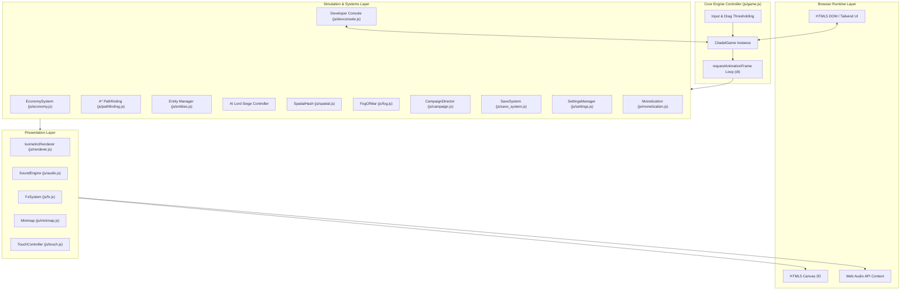

# Technical Architecture: Citadel of Legends: Shattered Realms

This document details the software architecture, coordinate transformations, simulation pipelines, and rendering engine behind **Citadel of Legends: Shattered Realms**.

---

## 1. High-Level System Architecture



---

## 2. Coordinate Pipeline & Isometric Math

The simulation operates on a discrete 2D orthogonal grid of size $64 \times 64$ cells ($gx, gy \in [0, 63]$), while rendering projects these coordinates into a standard $2:1$ dimetric isometric screen space.

### Forward Projection (`worldToScreen`)
Given grid coordinates $(gx, gy)$, with nominal tile width $W = 64$ and nominal tile height $H = 32$:

$$\text{screenX} = (gx - gy) \cdot \frac{W}{2} = (gx - gy) \cdot 32$$

$$\text{screenY} = (gx + gy) \cdot \frac{H}{2} = (gx + gy) \cdot 16$$

### Inverse Projection (`screenToWorld`)
When a user clicks or moves their mouse at canvas pixel coordinate $(P_x, P_y)$, the world grid coordinate is inverted by reversing camera translation and zoom:

$$L_x = \frac{P_x - \frac{\text{canvasWidth}}{2} - \text{camera.x}}{\text{camera.zoom}}$$

$$L_y = \frac{P_y - \text{offsetY} - \text{camera.y}}{\text{camera.zoom}}$$

$$gx = \left\lfloor \frac{1}{2} \left( \frac{L_x}{W/2} + \frac{L_y}{H/2} \right) \right\rfloor$$

$$gy = \left\lfloor \frac{1}{2} \left( \frac{L_y}{H/2} - \frac{L_x}{W/2} \right) \right\rfloor$$

Both $gx$ and $gy$ are clamped to $[0, \text{gridSize} - 1]$.

---

## 3. Rendering Pipeline & Depth Sorting

To ensure that tall isometric structures (such as the 3-story Citadel Keep, watchtowers, and fortress walls) properly occlude background structures while allowing units to pass behind and in front of them realistically:

1. **Terrain Layer:**
   - Evaluates visible bounding boxes via frustum culling:
     $$\text{viewMinX} = -\frac{\text{canvasWidth}}{2 \cdot \text{zoom}} - \frac{\text{camera.x}}{\text{zoom}} - \text{margin}$$
   - Only ground tiles intersecting this view rectangle are stroked and filled.
2. **Entity Depth Sorting:**
   - All dynamic units, static buildings, and active projectiles are collected into a flat render array.
   - Each item is assigned an isometric depth metric:
     $$\text{depth}_{\text{unit}} = u.x + u.y$$
     $$\text{depth}_{\text{building}} = b.gx + b.gy + \frac{b.w + b.h}{2}$$
   - Entities are sorted ascending ($\mathcal{O}(N \log N)$) and drawn from back to front.
3. **3D Stepped Architectural Drawing:**
   - Buildings are drawn as isometric prisms composed of three distinct shaded polygons (Left face: dark shadow; Right face: mid-tone; Top face: illuminated rooftop/walkway).
   - Additional details (merlons/crenels, conical turret roofs, faction banner flags, braziers) are composited on top of the base prism.

---

## 4. Economy & Population Lifecycle

The simulation runs a decoupled fixed-rate tick ($1.0\text{ s}$) inside [`js/economy.js`](../js/economy.js):

```mermaid
sequenceDiagram
    participant Loop as Game Loop
    participant Eco as EconomySystem
    participant Map as Building Footprints
    participant UI as DOM HUD

    Loop->>Eco: update(dt)
    Note over Eco: Accumulate time >= 1.0s
    Eco->>Map: Sum building productions (wood, stone, iron, pitch, food)
    Eco->>Eco: Consume Granary Food (pop * rationRate)
    alt Food Depleted
        Eco->>Eco: Apply Starvation Penalty (-15 Popularity)
    else Food Available
        Eco->>Eco: Apply Ration Popularity Modifiers
    end
    Eco->>Eco: Apply Taxes or Royal Gift Gold/Popularity
    Eco->>Eco: Calculate Net Popularity (0 - 100)
    alt Popularity >= 70
        Eco->>Loop: Spawn New Peasant at Keep
    else Popularity < 30
        Eco->>Loop: Despawn Discontent Peasant
    end
    Eco->>UI: Update Resource Badges & Popularity Indicator
```

---

## 5. Procedural Web Audio Engine

The sound system ([`js/audio.js`](../js/audio.js)) requires no external `.mp3` or `.wav` sound files:
- **Tone Generators:** Dual and triple oscillators with `exponentialRampToValueAtTime` curves for musical harmonics.
- **Noise Buffers:** Generated white noise filtered through resonant bandpass filters for sword clashes and weapon impacts.
- **Ambient Themes:** Procedural arpeggiators cycling through harmonic minor (Obsidian), pentatonic major (Solaris), and dorian/minor (Frostbound) scales every 2.8 seconds.
- **Autoplay Handling:** Automatically resumes suspended AudioContext upon the first user click, keydown, or touch gesture.

---

## 6. A\* Pathfinding System (`js/pathfinding.js`)

Units navigate the map using an $A^*$ grid pathfinding algorithm:
- Impassable nodes include water tiles, natural rock formations, and occupied enemy buildings or basalt walls.
- Manhattan distance heuristic:
  $$h(n) = |n.x - \text{goal}.x| + |n.y - \text{goal}.y|$$
- Bridge tiles across the river are designated as walkable corridors.
- Flying units (Faction Dragons) bypass the passability matrix, traveling in direct Euclidean lines.

---

## 7. Ballistics, Splash Damage & Marquee Selection

### Parabolic Ballistic Trajectories
Projectiles (`boulder`, `fire`, `arrow`) compute real-time flight progress $p \in [0, 1]$ over the Euclidean path:

$$p(t) = \min\left(1.0, \, p(t - \Delta t) + \frac{v \cdot \Delta t}{d_{\text{total}}}\right)$$

The parabolic arc height is evaluated via sinusoidal displacement:

$$y_{\text{arc}}(p) = \sin(p \cdot \pi) \cdot H_{\text{peak}}$$

Where $H_{\text{peak}} = 42\text{ px}$ for heavy catapult boulders, $24\text{ px}$ for dragon fireballs, and $14\text{ px}$ for arrows. A simulated circular shadow is rendered on the ground directly beneath $(x(p), y(p))$ with radius scaling inversely to height.

### Radial Splash Damage
Upon $p \ge 1.0$:
- Catapult boulders inflict $45\%$ splash damage to all units within radius $r = 1.8$ tiles.
- Dragon fireballs inflict $40\%$ splash damage within radius $r = 2.2$ tiles.

### Screen-Space Marquee Box Selection
Drag-box selection converts world coordinates of all friendly units to canvas screen space:

$$P_x = \frac{\text{canvasWidth}}{2} + \text{camera.x} + \text{screenX} \cdot \text{zoom}$$

$$P_y = \text{offsetY} + \text{camera.y} + \text{screenY} \cdot \text{zoom}$$

When $P_x \in [b_x, b_x + b_w]$ and $P_y \in [b_y, b_y + b_h]$, the unit is enqueued into `game.selectedUnits` (filtering out civilian worker peasants).


---

## 8. Main Loop & Simulation Step (v1.0)

A **single** `requestAnimationFrame` loop is started once in `CitadelGame.init()` and lives for the whole session (earlier builds started a new loop per mission, which stacked loops and multiplied game speed).

```
frame(realDt):
  if simulation running (playing, speed > 0, no briefing / menu / ad):
      remaining = realDt * simSpeed            # speeds 0x, 1x, 2x, 5x
      while remaining > 0 (max 6 sub-steps):   # 50 ms max step keeps combat stable at 5x
          update(min(remaining, 0.05))
  touch.update(realDt)                         # joystick pans in real time
  renderer.render(); minimap.render() (every 2nd frame)
```

`update(dt)` order: rebuild spatial hash → wave timer & spawn queue → economy (fixed 1 s ticks with catch-up) → buildings (towers, auras, cauldrons) → units → deaths → projectiles → floating text & FX → fog of war (4 Hz) → wave completion → objectives (2 Hz) → auto-save timer → monetization cooldowns → HUD (throttled to ~7 Hz; DOM writes skipped when unchanged).

## 9. Spatial Hash Grid (`js/spatial.js`)

Uniform grid with 4-tile buckets, rebuilt every step in $\mathcal{O}(N)$. Radius queries visit only the $\lceil 2r/4 \rceil^2$ buckets that intersect the query circle, so aggro scans, tower targeting, splash damage, healing auras and flame patches are $\mathcal{O}(1)$ on average instead of $\mathcal{O}(N)$. `queryUnitsNear()` falls back to a linear scan when no hash exists (lightweight test doubles).

**Measured:** 260 units simulate in ~0.2 ms/step (Node, `tests/test_runner.js` §19). In headless Chromium with *software* rasterization, a full 1080p frame with 270 units renders in ~5–8 ms after terrain caching (see §13).

## 10. A* Pathfinding v2

* Binary min-heap open set with lazy decrease-key (stale entries skipped via the closed set).
* Octile heuristic (admissible and consistent for 8-way movement with $\sqrt2$ diagonals).
* `game.buildingIndex: Map<id, Building>` makes occupancy checks $\mathcal{O}(1)$.
* Blocked targets resolve to the nearest passable tile within 3 rings; sealed targets return a path to the **closest reachable tile**, after which the unit's siege logic breaches the nearest hostile structure (`Unit.findBlockingStructure`).

## 11. Fog of War (`js/fog.js`)

Two `Uint8Array(64×64)` layers (`explored`, `visible`) and a `Float32Array` shade layer. Vision is recomputed at 4 Hz from friendly sources (Keep 12, tower 10, other buildings 4, units 5, flyers 7). Raw shade (0 visible / 0.55 explored / 0.94 unexplored) receives one 3×3 box blur for soft edges; displayed shade eases toward the target each frame. Explored state is saved as run-length-encoded text.

## 12. Persistence (`js/save_system.js`)

```json
{ "format": "citadel-of-legends-save", "schema": 1, "gameVersion": "1.0.0",
  "game": { "faction", "mapType", "aiDifficulty", "missionId", "elapsed", "tick", "stats", ... },
  "economy": { "res", "pop", "popularity", "rations", "taxes" },
  "map": { "size": 64, "tiles": "<4096 chars: g w r s b>" },
  "fog": { "enabled", "explored": "<RLE>" },
  "buildings": [{ "id", "type", "gx", "gy", "hp", "maxHp", "level", "isUnderConstruction", "isEnemy", "tag" }],
  "units": [{ "id", "type", "x", "y", "hp", "maxHp", "faction", "isEnemy", "state", "targetId", "path" }],
  "waves": { "timer", "current", "tier", "slain", "spawnQueue", "activeWaves" },
  "campaign": { mission telemetry }, "nextEntityId": 1234 }
```

**Trust boundary:** imported files are untrusted. `SaveSystem.validate()` checks format/schema, whitelists every building/unit type against the definitions, bounds-checks coordinates, rejects duplicate ids and oversize payloads (2 MB, 2,000 entities), and only known fields are copied (no object spreading of user data → no prototype pollution). Target references are re-linked by id after load, and the global entity id counter is advanced past the highest loaded id.

## 13. Rendering Optimisations

* **Ground layer cache:** terrain is baked once per map into an offscreen canvas; fog is composited onto a second layer at 10 Hz; each frame performs a single viewport-clipped `drawImage` (terrain cost 9.0 ms → 2.4 ms in software rendering).
* **Labels on demand:** building names render for keeps, selection, hover or zoom ≥ 1.6.
* **Particle caps & adaptive quality:** combat FX capped at 500, flame patches at 24; weather density drops automatically when the smoothed FPS falls below 40.

## 14. Campaign Director (`js/campaign.js`)

Missions are pure data in `CAMPAIGN_MISSIONS` (`config.js`): `objectives[]` (`buildings`, `buildingCount`, `population`, `resource`, `produced`, `trained`, `wavesSurvived`, `destroyEnemyKeep`, `destroyBuildingType`, `killGeneral`), one `bonus` (`noStarvation`, `structuresStanding`, `generalSlainBy`, `noBuild`, `regionKills`, `timeLimit`, `minTax`, `lifesteal`, `destroyAllTagged`), wave config and scripted structures. The director collects telemetry via hooks (production, recruits, builds, kills with attacker attribution, starvation, tax changes, lifesteal) and evaluates objectives twice per second. Progress/unlocks persist under `citadel.campaign.progress`.

## 15. Monetization & Distribution

* `js/monetization.js` exposes a facade over portal adapters (`none`, `itch`, `desktop` → no ads; `crazygames`, `poki`, `gamedistribution` → SDK). Portal is chosen by `window.CITADEL_PORTAL` (injected by the release packager), `?portal=` or hostname. SDK scripts are injected only for ad portals. Ads pause the simulation and mute audio.
* `scripts/build_web_release.js` produces reproducible ZIPs (fixed timestamps, own DEFLATE writer in `scripts/zip.js`) for web/itch, CrazyGames, Poki and the marketing website.
* `desktop/` wraps the same files in Electron: custom privileged `app://` scheme, CSP on every response, sandbox + context isolation, no Node in the renderer, navigation/popup/permission lockdown. Security helpers live in `desktop/security.js` and are unit-tested.
* `sw.js` precaches the full game shell; it never intercepts cross-origin (ad SDK) requests.

## 16. Quality Gates

| Gate | Command | Scope |
| :--- | :--- | :--- |
| Unit & integration | `npm test` | 340 assertions: engine, gameplay, campaign, persistence, perf, monetization, packaging, legal & marketing assets |
| Browser E2E | `npm run test:e2e` | Real Chromium: menus, briefing, build via UI, minimap, speed, save→reload→load, settings persistence, offline PWA, mobile touch, marketing site |
| CI | `.github/workflows/ci.yml` | Both suites + release build on every push/PR |
| Release | `.github/workflows/release.yml` | On `v*` tags: web bundles + Windows/macOS/Linux installers → GitHub Release |
