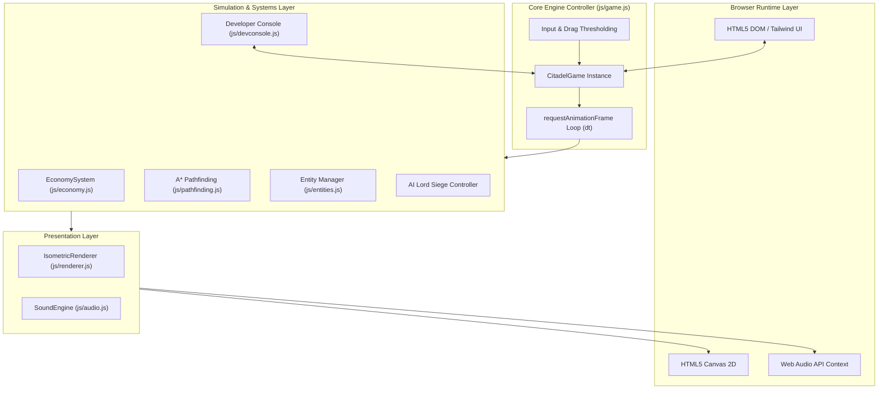

# Technical Architecture: Citadel of Legends: Shattered Realms

This document details the software architecture, coordinate transformations, simulation pipelines, and rendering engine behind **Citadel of Legends: Shattered Realms**.

---

## 1. High-Level System Architecture



---

## 2. Coordinate Pipeline & Isometric Math

The simulation operates on a discrete 2D orthogonal grid of size $64 \times 64$ cells ($gx, gy \in [0, 63]$), while rendering projects these coordinates into a standard $2:1$ dimetric isometric screen space.

### Forward Projection (`worldToScreen`)
Given grid coordinates $(gx, gy)$, with nominal tile width $W = 64$ and nominal tile height $H = 32$:

$$\text{screenX} = (gx - gy) \cdot \frac{W}{2} = (gx - gy) \cdot 32$$

$$\text{screenY} = (gx + gy) \cdot \frac{H}{2} = (gx + gy) \cdot 16$$

### Inverse Projection (`screenToWorld`)
When a user clicks or moves their mouse at canvas pixel coordinate $(P_x, P_y)$, the world grid coordinate is inverted by reversing camera translation and zoom:

$$L_x = \frac{P_x - \frac{\text{canvasWidth}}{2} - \text{camera.x}}{\text{camera.zoom}}$$

$$L_y = \frac{P_y - \text{offsetY} - \text{camera.y}}{\text{camera.zoom}}$$

$$gx = \left\lfloor \frac{1}{2} \left( \frac{L_x}{W/2} + \frac{L_y}{H/2} \right) \right\rfloor$$

$$gy = \left\lfloor \frac{1}{2} \left( \frac{L_y}{H/2} - \frac{L_x}{W/2} \right) \right\rfloor$$

Both $gx$ and $gy$ are clamped to $[0, \text{gridSize} - 1]$.

---

## 3. Rendering Pipeline & Depth Sorting

To ensure that tall isometric structures (such as the 3-story Citadel Keep, watchtowers, and fortress walls) properly occlude background structures while allowing units to pass behind and in front of them realistically:

1. **Terrain Layer:**
   - Evaluates visible bounding boxes via frustum culling:
     $$\text{viewMinX} = -\frac{\text{canvasWidth}}{2 \cdot \text{zoom}} - \frac{\text{camera.x}}{\text{zoom}} - \text{margin}$$
   - Only ground tiles intersecting this view rectangle are stroked and filled.
2. **Entity Depth Sorting:**
   - All dynamic units, static buildings, and active projectiles are collected into a flat render array.
   - Each item is assigned an isometric depth metric:
     $$\text{depth}_{\text{unit}} = u.x + u.y$$
     $$\text{depth}_{\text{building}} = b.gx + b.gy + \frac{b.w + b.h}{2}$$
   - Entities are sorted ascending ($\mathcal{O}(N \log N)$) and drawn from back to front.
3. **3D Stepped Architectural Drawing:**
   - Buildings are drawn as isometric prisms composed of three distinct shaded polygons (Left face: dark shadow; Right face: mid-tone; Top face: illuminated rooftop/walkway).
   - Additional details (merlons/crenels, conical turret roofs, faction banner flags, braziers) are composited on top of the base prism.

---

## 4. Economy & Population Lifecycle

The simulation runs a decoupled fixed-rate tick ($1.0\text{ s}$) inside [`js/economy.js`](file:///d:/Citadel%20of%20Legends/js/economy.js):

```mermaid
sequenceDiagram
    participant Loop as Game Loop
    participant Eco as EconomySystem
    participant Map as Building Footprints
    participant UI as DOM HUD

    Loop->>Eco: update(dt)
    Note over Eco: Accumulate time >= 1.0s
    Eco->>Map: Sum building productions (wood, stone, iron, pitch, food)
    Eco->>Eco: Consume Granary Food (pop * rationRate)
    alt Food Depleted
        Eco->>Eco: Apply Starvation Penalty (-15 Popularity)
    else Food Available
        Eco->>Eco: Apply Ration Popularity Modifiers
    end
    Eco->>Eco: Apply Taxes or Royal Gift Gold/Popularity
    Eco->>Eco: Calculate Net Popularity (0 - 100)
    alt Popularity >= 70
        Eco->>Loop: Spawn New Peasant at Keep
    else Popularity < 30
        Eco->>Loop: Despawn Discontent Peasant
    end
    Eco->>UI: Update Resource Badges & Popularity Indicator
```

---

## 5. Procedural Web Audio Engine

The sound system ([`js/audio.js`](file:///d:/Citadel%20of%20Legends/js/audio.js)) requires no external `.mp3` or `.wav` sound files:
- **Tone Generators:** Dual and triple oscillators with `exponentialRampToValueAtTime` curves for musical harmonics.
- **Noise Buffers:** Generated white noise filtered through resonant bandpass filters for sword clashes and weapon impacts.
- **Ambient Themes:** Procedural arpeggiators cycling through harmonic minor (Obsidian), pentatonic major (Solaris), and dorian/minor (Frostbound) scales every 2.8 seconds.
- **Autoplay Handling:** Automatically resumes suspended AudioContext upon the first user click, keydown, or touch gesture.

---

## 6. A\* Pathfinding System (`js/pathfinding.js`)

Units navigate the map using an $A^*$ grid pathfinding algorithm:
- Impassable nodes include water tiles, natural rock formations, and occupied enemy buildings or basalt walls.
- Manhattan distance heuristic:
  $$h(n) = |n.x - \text{goal}.x| + |n.y - \text{goal}.y|$$
- Bridge tiles across the river are designated as walkable corridors.
- Flying units (Faction Dragons) bypass the passability matrix, traveling in direct Euclidean lines.
