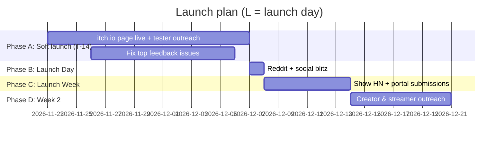

# Go-To-Market Strategy & Launch Playbook — Citadel of Legends: Shattered Realms

> **Owner:** Commercial lead · **Version:** 1.0 · **Last updated:** 2026-11-11
> **Status:** Ready to execute once the placeholders in [`LAUNCH_CHECKLIST.md`](LAUNCH_CHECKLIST.md) are filled.

---

## 1. Positioning

| | |
| :--- | :--- |
| **Category** | Free browser castle-builder / real-time strategy |
| **One-liner** | *Build a medieval citadel, feed your people, and pour boiling pitch on dragon-backed sieges — free, in your browser, no install.* |
| **Primary audience** | PC strategy players (25–44) nostalgic for early-2000s castle sims; play on lunch breaks and low-spec laptops |
| **Secondary audience** | Web-portal casual strategy players (13+), Chromebook/tablet players, indie-game streamers |
| **Differentiators** | 1) Loads in ~1 second, zero install, works offline. 2) Three genuinely asymmetric factions + 9 missions for free. 3) No tracking, no account, no pay-to-win. 4) Every visual and sound generated live (great "how is this a browser game?" hook for tech audiences). |
| **Proof points** | 355 KiB web build · 250+ units at 60 FPS · fog of war, minimap, save/export, touch controls · 300+ automated tests |

**Messaging pillars:** *Instant* (play in one click) · *Deep* (economy + siege, not a clicker) · *Respectful* (free, no tracking, cosmetic-only supporter tier) · *Crafted* (procedural art and audio, solo-indie story).

---

## 2. Business model

| Stream | Mechanism | Where | Notes |
| :--- | :--- | :--- | :--- |
| **Portal ad revenue share** | Rewarded "Royal Respite" (+150 stone, opt-in) and interstitials at mission transitions only, capped to one per 3 min | CrazyGames, Poki, GameDistribution | Implemented in `js/monetization.js`. Revenue share is set by each portal's publisher agreement. |
| **Royal Supporter Edition** | One-time tip (suggested **USD 4.99**, pay-what-you-want minimum USD 2) → code unlocking golden banners, developer commentary, ad-free portal play | itch.io (primary), Ko-fi/Buy Me a Coffee (secondary) | Cosmetic only — never sells power. Codes generated by `scripts/generate_supporter_codes.js`. |
| **Desktop edition** | Same game packaged for Windows/macOS/Linux, "name your price" (USD 0+, suggested 4.99) | itch.io, GitHub Releases | Electron build in `desktop/`. Steam is a post-launch option (see §9). |
| **Sponsorship / licensing** | Exclusive portal sponsorship or white-label licence | Inbound via press kit | Evaluate only after launch data (§8). |

**Pricing rationale:** free-to-play maximises reach on portals where the audience expects free games; the tip model converts the most engaged ~0.5–2% without gating content. Pay-what-you-want on itch.io historically converts far better than a fixed paywall for unknown indie titles.

### Revenue scenarios (first 90 days — assumptions, not forecasts)

| Scenario | Total plays | Supporter conversion | Supporters @ avg $4 | Portal ad revenue (RPM assumption) | Total |
| :--- | ---: | ---: | ---: | ---: | ---: |
| Conservative | 50,000 | 0.3% | $600 | $1.00 per 1k plays → $50 | **≈ $650** |
| Base | 250,000 | 0.6% | $6,000 | $2.00 per 1k plays → $500 | **≈ $6,500** |
| Breakout (front page of a major portal + HN) | 1,500,000 | 0.8% | $48,000 | $3.00 per 1k plays → $4,500 | **≈ $52,500** |

Replace these assumptions with real numbers from portal dashboards and itch.io analytics after Phase A; re-plan at the end of Week 2.

---

## 3. Launch timeline

### Phase A — T-14 days: itch.io soft launch & feedback
- Publish the itch.io page (HTML5 embed from `dist/citadel_of_legends_v1.0_web.zip`, 1280×720 viewport, "fullscreen button" on, "mobile friendly" on).
- Upload desktop builds as downloadable files; enable pay-what-you-want with a suggested price.
- Recruit 20–40 testers: itch.io devlog post, r/playmygame, r/WebGameDev feedback threads, personal network, Discord.
- Collect feedback with a pinned Discord channel + itch.io comments. Triage daily; ship fixes as patch releases (`npm run build:web`).
- **Exit criteria:** median first session ≥ 10 min (ask testers), zero crash reports open, ≥ 10 positive written comments for social proof.

### Phase B — Launch Day: Reddit blitz
Post **one subreddit per ~2 hours** (not all at once), each tailored. Respect each community's self-promotion rules (read the sidebar; many require participation history or have dedicated self-promo days). Reply to every comment for the first 6 hours.

| Subreddit | Angle | Template |
| :--- | :--- | :--- |
| r/WebGames | "Play instantly in your browser" — link straight to the game | #1 |
| r/IndieGaming | Solo-dev journey + GIF | #2 |
| r/StrategyGames | Mechanics depth: economy loop, siege AI, factions | #3 |
| r/stronghold | Homage to the classic castle-sim genre (*inspired by*, not affiliated) | #4 |
| r/incremental_games / r/BaseBuildingGames | Only if rules allow; economy-focused angle | #3 (adapted) |

Same day: X/Twitter + Bluesky + Mastodon thread (Template #5), Discord announcement, itch.io devlog.

### Phase C — Launch Week: Show HN & portals
- **Show HN** (Template #6) on a weekday morning US Eastern time. Title rule: start with "Show HN:", be factual, no superlatives. Link the playable game, not the landing page. Be present in the thread for 4+ hours; answer technical questions candidly.
- Submit portal bundles: CrazyGames developer portal (`dist/..._crazygames.zip`), Poki for Developers (`dist/..._poki.zip`), GameDistribution. Expect review/QA cycles; track status in the KPI sheet.
- Press emails (Template #7) to 15–25 outlets/blogs covering browser and indie strategy games.

### Phase D — Week 2: creator & streamer outreach
- Targets (from the plan; verify each creator's current content focus and business-contact method before emailing): **Splattercat**, **KatherineOfSky**, **Nookrium**, plus 20 smaller strategy/base-builder channels (5k–100k subscribers) found via YouTube search and Twitch's Strategy category.
- Personalised email (Template #8) with a supporter code, the press kit, and explicit monetisation permission (EULA §4).
- Follow up once after 5 business days; never more than twice.

---

## 4. Channel plan & owned assets

| Asset | Location | Purpose |
| :--- | :--- | :--- |
| Landing page | `marketing/index.html` (bundled as `dist/..._website.zip`) | Conversion hub: play, wishlist/tip, newsletter, Discord |
| Press kit | `marketing/presskit.html` | presskit()-format factsheet, pitches, screenshots, logos |
| Gameplay GIF & screenshots | `marketing/assets/` | Reddit, social, store pages (regenerate with `npm run build:media`) |
| OG/social card | `marketing/assets/og-image.png` | Link previews |
| Discord | `BUSINESS_CONFIG.discordUrl` | Community, feedback, launch notifications |
| Newsletter | Landing page form (`data-endpoint`) | Owned audience for future releases |

---

## 5. KPIs & targets (first 30 days)

| KPI | Definition | Target (base) | Source |
| :--- | :--- | ---: | :--- |
| Total plays | Game loads across all portals + itch | 100,000 | Portal dashboards, itch analytics |
| D1 return rate | Players returning next day | ≥ 15% | Portal dashboards |
| Avg. session length | Minutes per session | ≥ 12 min | Portal dashboards |
| Landing → Play CTR | Clicks on "Play Free" / landing visits | ≥ 35% | Host analytics (privacy-friendly, server logs) |
| Newsletter signups | Confirmed double opt-ins | 1,000 | Email provider |
| Discord members | Joined | 500 | Discord |
| Supporter conversion | Supporters / unique players | ≥ 0.5% | itch.io sales |
| Reddit launch posts | Posts with ≥ 100 upvotes | 2 of 4 | Reddit |
| Creator coverage | Videos/streams published | 5 | Manual tracking |

Review weekly. If D1 < 10% or session length < 8 min, prioritise onboarding (tutorial tips) over acquisition.

---

## 6. Promotional copy templates

### Template 1 — r/WebGames post
**Title:** Citadel of Legends — build a medieval castle, survive dragon sieges (free, plays instantly in browser)
**Body:**
> I made a castle-builder RTS that runs entirely in the browser — no download, no account. Build hovels and bakeries, keep your peasants fed and taxed (but not *too* taxed), then hold the bridge with archers, boiling pitch and your faction's dragon.
>
> ▶ Play: [GAME_URL]
>
> 3 factions, 9 story missions, fog of war, save/export, works on tablets too. Feedback very welcome!

### Template 2 — r/IndieGaming (dev story + GIF)
**Title:** I built a castle-builder RTS with zero engines — every sprite and sound is generated live in the browser
**Body:**
> [GIF: marketing/assets/gameplay.gif]
>
> Citadel of Legends started as a single 1,100-line HTML file. [TIMEFRAME] later it's a 9-mission campaign with three asymmetric factions, A* siege AI that batters down your walls, and a Web Audio synth that does everything from sword clashes to wolf howls. The whole web build is ~355 KB.
>
> It's free: [GAME_URL]. Happy to answer anything about the tech or design!

### Template 3 — r/StrategyGames (mechanics depth)
**Title:** Free browser castle-sim where your economy *is* your defense — rations, taxes, popularity and siege waves
**Body:**
> Every peasant is a worker, taxpayer and mouth to feed. Popularity drives immigration; famine or extortion empties your citadel. Enemy waves path-find to your weakest wall and breach it if they have to; sieging troops turn on defenders who sally out.
>
> Factions: Solaris (healing paladins, tax bonus), Frostbound (stone economy, Valkyries that fly over walls), Obsidian (stealth Bloodknights, pitch cauldrons). Bonus objectives like "slay the enemy general *with your dragon*".
>
> [GAME_URL] — I'd love balance feedback.

### Template 4 — r/stronghold (genre homage)
**Title:** A free browser castle-sim inspired by the classics — would love feedback from this community
**Body:**
> Long-time fan of the genre here. I made *Citadel of Legends*, an independent, free browser game inspired by the castle sims many of us grew up with (not affiliated with any existing franchise). Popularity, rations and taxes, boiling pitch, catapults, plus a fantasy twist with dragons and werewolves.
>
> [GAME_URL] — what mechanics from the classics would you most want to see next?

### Template 5 — Social thread (X / Bluesky / Mastodon)
> 1/ 🏰 Citadel of Legends: Shattered Realms is out — a free castle-builder RTS you can play right now in your browser. No install, no account. [GAME_URL] [GIF]
>
> 2/ Feed your people. Tax them (carefully). When the war horns sound, pour boiling pitch from the walls and send your dragon into the sky. 🐉🔥
>
> 3/ 3 asymmetric factions · 9-mission campaign · fog of war · save anywhere · works offline · touch controls
>
> 4/ Every sprite and sound is generated live — no engine, no tracking, ~355 KB. Made by a tiny indie studio. If you enjoy it, the Royal Supporter Edition keeps us building: [SUPPORTER_URL] #indiegame #gamedev #strategy

### Template 6 — Show HN
**Title:** Show HN: Citadel of Legends – a zero-dependency castle-builder RTS in HTML5 Canvas
**Body:**
> Citadel of Legends is a real-time castle-builder that runs in the browser with no engine, framework or build step at runtime: a hand-written 2.5D isometric Canvas renderer, A* pathfinding with a binary heap, a spatial hash that keeps 250+ units at 60 FPS, and Web Audio synthesis for all music and SFX (no audio files).
>
> Saves are validated JSON you can export/import; the PWA works offline; there's no tracking. The web build is ~355 KB including fonts.
>
> Play: [GAME_URL] · Source/devlog: https://github.com/Shojaeei/citadel-of-legends
>
> I'm happy to dig into the renderer, the siege AI (units breach walls when the path is sealed), or what it took to make it touch-friendly.

### Template 7 — Press email
**Subject:** Free browser castle-builder with dragons & boiling pitch — Citadel of Legends launches [DATE]
> Hi [NAME],
>
> I'm [YOUR NAME] from [STUDIO NAME]. On [DATE] we're launching *Citadel of Legends: Shattered Realms*, a free castle-builder RTS that plays instantly in any browser (and offline as an app).
>
> - Three asymmetric factions and a 9-mission campaign
> - Every visual and sound generated live — the whole game is ~355 KB
> - No accounts, no tracking, no pay-to-win
>
> Play: [GAME_URL] · Press kit (screenshots, GIF, logos, factsheet): [PRESSKIT_URL]
>
> Happy to provide a supporter key or answer questions. Thanks for your time!
>
> [YOUR NAME] · [PRESS EMAIL]

### Template 8 — Creator / streamer outreach
**Subject:** Free castle-sim for your channel — Citadel of Legends (monetisation OK)
> Hi [CREATOR NAME],
>
> I loved your [SPECIFIC VIDEO/SERIES] — especially [SPECIFIC DETAIL]. I think your audience might enjoy *Citadel of Legends*, a free browser castle-builder where you balance rations and taxes, then hold the walls against dragon-backed sieges.
>
> - Plays instantly: [GAME_URL] (desktop build also available)
> - Here's a Royal Supporter code for the cosmetic extras: [CODE]
> - You're free to monetise videos and streams (EULA §4) — no approval needed
> - Assets: [PRESSKIT_URL]
>
> No pressure at all — thanks for making the content you do.
>
> [YOUR NAME], [STUDIO NAME]

### Template 9 — itch.io store page copy
**Short description (≤ 120 chars):** Build a medieval citadel, feed your people and survive dragon-backed sieges. Free castle-builder RTS.
**Tags:** strategy, real-time-strategy, city-builder, castle, medieval, fantasy, dragons, singleplayer, html5, offline
**Long description:**
> **Raise a citadel. Feed your people. Hold the walls.**
>
> *Citadel of Legends: Shattered Realms* is a tactical castle-builder RTS. Grow a living medieval settlement where every peasant is a worker, a taxpayer and a mouth to feed — then defend it against siege waves with watchtowers, boiling pitch cauldrons, catapults and dragons.
>
> **Features** — 3 asymmetric factions · 9-mission story campaign with bonus objectives · deep economy (rations, taxes, popularity, immigration) · fog of war & radar minimap · save anywhere + export · 0x/1x/2x/5x speed · rebindable keys & high-contrast mode · touch controls · works offline
>
> **Royal Supporter Edition** — pay what you want to unlock golden citadel banners, developer commentary and ad-free portal play. 100% cosmetic.

### Template 10 — Portal submission / newsletter launch announcement
**Portal description (CrazyGames / Poki / GameDistribution):**
> Build your castle, keep your people happy and defend your walls! In Citadel of Legends you gather wood, stone and food, grow your town and train an army of archers, knights and even dragons. Pour boiling pitch on invaders and conquer the enemy keep across the river. Choose from three kingdoms and play a 9-mission story campaign.
> **Controls:** Click to build/select · Right-click (or long-press) to move/attack · Drag or WASD to move the camera · Mouse wheel/pinch to zoom · Space to center on your keep.

**Newsletter subject:** The siege begins: Citadel of Legends is live ⚔️
> The gates are open! Citadel of Legends is free to play right now: [GAME_URL]. Thank you for being part of the War Council — reply to this email with anything you'd like to see next.

---

## 7. Community management
- **Response SLA:** Discord/itch comments within 24 h during launch month; bug reports acknowledged same day.
- **Moderation:** Discord AutoMod + 2 trusted moderators by Week 2; no personal data requested in public channels.
- **Feedback loop:** weekly "War Council" post summarising what changed because of player feedback.

## 8. Risks & mitigations

| Risk | Likelihood | Impact | Mitigation |
| :--- | :---: | :---: | :--- |
| Reddit posts removed for self-promotion | Medium | Medium | Read rules, build comment history, stagger posts, use dedicated self-promo threads |
| Portal rejects bundle (SDK/QA) | Medium | High | Bundles already isolate SDK calls and mute audio during ads; budget 1–2 review cycles |
| Trademark confusion with classic castle-sim franchises | Low | High | Never use third-party marks in titles/assets; "inspired by" language only; original names and art |
| Low D1 retention | Medium | High | Prioritise onboarding tips and mission-1 pacing in first patch |
| Supporter codes shared publicly | Medium | Low | Perks are cosmetic; rotate code batches; revoke leaked hashes in next patch |
| Server costs from a traffic spike | Low | Medium | Static hosting + CDN; game is 355 KB and cacheable |

## 9. Post-launch roadmap (commercial)
1. **Month 1:** patch cadence weekly; add 3 new skirmish maps based on feedback.
2. **Month 2:** evaluate Steam release (Steamworks fee, Steam Deck verification, achievements) only if itch.io supporter conversion ≥ 0.5% and D7 ≥ 5%.
3. **Month 3:** localisation (DE, FR, ES, PT-BR, RU) if > 30% of plays are non-English per portal dashboards.
