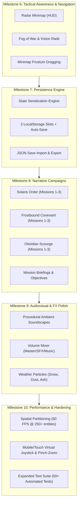

# Master Plans & Execution Roadmap: Citadel of Legends

> **Document Version:** 1.0.0  
> **Status:** Active Roadmap & Agent Handoff Specification  
> **Repository:** [https://github.com/Shojaeei/citadel-of-legends](https://github.com/Shojaeei/citadel-of-legends)  
> **Engine:** Zero-dependency HTML5 Canvas 2D + Web Audio API  

---

## 🎯 Executive Summary & Mission

This document defines the complete end-to-end master execution plan for **Citadel of Legends: Shattered Realms**. The project has completed Phase 1 (Modular Engine), Phase 2 (A* Pathfinding & Siege Battles), and Phase 3 (Faction Asymmetry, Ballistics & Tactical Abilities).

The next operational objective is twofold:
1. **Track 1: Gameplay Engine & Feature Completion (v1.0 Gold Master)** — Elevate the technical simulation into a fully featured, commercial-grade RTS with radar minimap, fog of war, full save/load state persistence, 9 narrative campaign missions, weather FX, and extended test coverage.
2. **Track 2: Commercial Business & Go-To-Market Infrastructure** — Build and launch the commercial distribution, monetization, marketing landing page, press kit, multi-platform packaging (PWA, Desktop, Web Portals), and legal compliance suite so the project can operate autonomously as a profitable indie gaming business.

---

## 🤖 Autonomous Agent Handoff Prompt

When assigning another AI agent to take over and execute these plans, provide the following verbatim `/goal` prompt:

```markdown
/goal You are the Lead Game Director, Principal Engine Architect, and Chief Commercial Officer for "Citadel of Legends: Shattered Realms" located in this workspace.

Your mission is twofold:
1. COMPLETE AND SHIP THE GAME to a polished, feature-complete v1.0 Gold Master standard.
2. BUILD AND LAUNCH THE COMMERCIAL BUSINESS INFRASTRUCTURE so the game can immediately monetize, distribute across web/desktop portals, attract players, and operate as an indie gaming business.

Follow the specifications in `docs/PLANS.md` and `docs/ARCHITECTURE.md`. Do not stop until every technical milestone, automated test suite, business asset, marketing funnel, distribution package, and legal document is created, tested, verified, and committed to git.

Refer to Track 1 (Engine & Gameplay) and Track 2 (Commercial Business) in `docs/PLANS.md`. Ensure all tests in `tests/test_runner.js` pass with 100% success rate.
```

---

## 🗺️ Track 1: Gameplay Engine & Feature Completion (v1.0 Gold Master)



### 1.1 Radar Minimap & Fog of War
- **Interactive Corner Radar (`canvas`):**
  - Render an isometric-to-orthogonal 2D scaled view of the $64 \times 64$ world grid.
  - Distinct terrain color representation (deep river blue, lush grass green, mountain grey, timber brown).
  - Entity blips: Friendly buildings (cyan/gold), friendly units (white/green), enemy invaders (crimson red), resources (amber).
  - Real-time camera frustum trapezoid/bounding box showing current screen viewport.
  - Left-click or drag on the minimap immediately re-centers camera.
- **Dynamic Fog of War / Exploration Shroud:**
  - Dynamic discovery matrix ($64 \times 64$ boolean `explored` and `visible` flags).
  - Citadel Keep grants baseline 12-tile vision; Watchtowers grant 10-tile radius; units grant 5-tile radius.
  - Smooth alpha gradient masking on unrevealed terrain.

### 1.2 Persistence & Save/Load Engine
- **Module:** `js/save_system.js` (or integrated within `CitadelGame`).
- **Storage Targets:**
  - Browser `localStorage` with 3 manual save slots and 1 rolling auto-save slot (triggers every 3 minutes and upon wave completion).
  - One-click "Export Save File" (`.citadelsave` / JSON format) and "Import Save File" via HTML5 File API.
- **Serialization Schema:**
  - Game state: active faction, current campaign mission, elapsed game time, tick counter.
  - Economy: stockpile array (`wood`, `stone`, `iron`, `pitch`, `gold`, `food`, `honor`), popularity rating, immigration queue, ration tier, tax rate.
  - Buildings: array of `{ id, type, gx, gy, hp, maxHp, level, isUnderConstruction }`.
  - Units: array of `{ id, type, x, y, hp, maxHp, faction, state, targetId, path }`.
  - Waves: active invasion timer, wave difficulty tier, slain enemy counter.

### 1.3 Full 9-Mission Scripted Narrative Campaign
Expand the story campaigns into 9 comprehensive, multi-objective historical sagas:

| Faction | Mission | Title | Primary Objective | Secondary Bonus |
| :--- | :--- | :--- | :--- | :--- |
| **Solaris Order** | 1 | *The Gathering Storm* | Construct Keep settlement, reach 150 population, hoard 800 food | Zero peasant starvation |
| **Solaris Order** | 2 | *Siege of Camelot's Gate* | Survive 5 waves using boiling pitch and archer towers | Keep all outer towers standing |
| **Solaris Order** | 3 | *Dragon's Dawn* | Consecrate Cathedral of Light, recruit Solaris Dragon, destroy Blackfang Keep | Slay enemy general with Dragon |
| **Frostbound Covenant** | 1 | *The Glacial Trail* | Quarry 500 basalt, establish 3 hunter outposts in frozen tundra | Build zero wood cabins |
| **Frostbound Covenant** | 2 | *Frostpeak Pass Ambush* | Repel armored cavalry using Frost Giants & Valkyrie dive strikes | Slay 25 enemies in pass bottleneck |
| **Frostbound Covenant** | 3 | *The Ice Wyvern's Domain* | Scale glacial mountain, hatch Ice Wyvern, vanquish Northern Warlord | Complete in under 12 minutes |
| **Obsidian Scourge** | 1 | *Transylvanian Reckoning* | Harvest 300 brimstone, build 4 boiling pitch cauldrons | Never lower tax rate below High |
| **Obsidian Scourge** | 2 | *Blood Crucible Bastion* | Infiltrate enemy garrison using stealthy Vampire Bloodknights | Regenerate 1000 HP via lifesteal |
| **Obsidian Scourge** | 3 | *Eclipse of the Abyss* | Build 3 siege catapults, breach Imperial Citadel with Abyss Dragon | Destroy all enemy gatehouses |

### 1.4 Audiovisual & Atmospheric Enhancements
- **Sound Engine (`js/audio.js`):**
  - Master, SFX, and Ambient/Music independent volume controls with persistence.
  - Faction ambient soundscapes:
    - *Solaris:* Gentle pastoral birdsong, wind through green pines, distant abbey chimes.
    - *Frostbound:* Howling Arctic wind, glacial creaks, crackling campfire warmth.
    - *Obsidian:* Eerie subterranean hum, bubbling pitch cauldrons, nocturnal wolf howls.
- **Particle System:**
  - Biome weather: floating golden motes (Solaris), drifting snow flurries (Frostbound), cinder embers/ash (Obsidian).
  - Combat feedback: sword sparks, blood splatters, stone rubble dust upon wall/tower collapse, residual flame patches after dragon breath.

### 1.5 Performance Hardening & Accessibility
- **Spatial Hash Grid:** $\mathcal{O}(1)$ entity neighbor queries and collision detection for 250+ simultaneous units at steady 60 FPS.
- **Accessibility & Settings:**
  - High-contrast entity outline mode for visual clarity.
  - Game speed toggle (`0x` Pause, `1x` Normal, `2x` Fast, `5x` Ultra).
  - Rebindable keyboard controls.
  - Full mobile/tablet touch gesture compatibility (pinch-to-zoom, two-finger camera pan, tap-to-select).

---

## 💼 Track 2: Commercial Business & Go-To-Market Infrastructure

```mermaid
flowchart LR
    subgraph Funnel ["Marketing & Acquisition"]
        LP["Landing Page (marketing/index.html)"]
        Press["Press Kit (presskit.html)"]
        GTM["GTM Playbook (Reddit, Twitter, Streamers)"]
    end

    subgraph Distribution ["Multi-Platform Distribution"]
        WebPortal["Web Portals (itch.io, CrazyGames, Poki)"]
        Desktop["Desktop App (Tauri / Electron)"]
        PWA["Mobile/Web PWA (manifest + sw.js)"]
    end

    subgraph Monetization ["Monetization & Legal"]
        Ads["Portal Ad Hooks (js/monetization.js)"]
        Supporter["Royal Supporter Edition / Tips"]
        Legal["EULA, Privacy, Terms, GDPR"]
    end

    Funnel --> Distribution
    Distribution --> Monetization
```



### 2.1 High-Converting Marketing Landing Page (`marketing/index.html`)
A standalone, production-ready marketing website designed to capture players, press, and wishlists:
- **Hero Section:** High-impact medieval typography, dynamic animated canvas preview, "Play Free in Browser" primary CTA, "Download Desktop Edition" secondary CTA.
- **Feature Showcase:** 3-column interactive breakdown of Asymmetric Factions, Deep Castle Economy, and Real-Time Siege Warfare.
- **Interactive Lore & Faction Explorer:** Audio preview buttons, troop stats, and faction backstory.
- **Community Capture Form:** Newsletter / Discord waitlist integration.
- **Social Proof & Badges:** HTML5 Canvas, Web Audio API, Zero Dependencies, Open Source MIT/Commercial.

### 2.2 Press & Media Kit (`marketing/presskit.html`)
Follows the standard Rami Ismail `presskit()` format:
- **Factsheet:** Developer, release date, platforms, website, price, contact.
- **Elevator Pitches:** 40-word, 100-word, and full narrative descriptions.
- **High-Resolution Assets:** Logos, faction crests, gameplay screenshots, gameplay GIF captures.
- **Key Features Bullet Points** optimized for game journalists and gaming subreddits.

### 2.3 Multi-Platform Packaging & Distribution Pipelines
1. **Progressive Web App (PWA):**
   - `manifest.json` with medieval app icons, standalone display mode, orientation locking.
   - `sw.js` (Service Worker) caching core assets for 100% offline gameplay anywhere.
2. **Web Portal Release Bundle (`scripts/build_web_release.js`):**
   - Automated zip packager generating `citadel_of_legends_v1.0_web.zip`.
   - Optimized for instant drag-and-drop submission to:
     - **itch.io** (HTML5 Web Game format).
     - **CrazyGames** (Self-hosted or hosted package).
     - **Poki & Armor Games** web submissions.
3. **Desktop Standalone Executable:**
   - Standalone Electron or Tauri build configuration for Windows (`.exe`), macOS (`.dmg`), and Linux (`.AppImage`).

### 2.4 Monetization Architecture (`js/monetization.js`)
Clean, non-intrusive revenue hooks that maintain player goodwill:
- **Portal SDK Adapter:** Universal event hooks for rewarded ads (e.g., "Watch brief respite to receive +150 emergency stone"), level-transition interstitials, and banner anchors.
- **Royal Supporter Edition:** In-game optional tip jar / supporter link (itch.io reward / Buy Me a Coffee / Patreon) unlocking decorative golden citadel banners and developer commentary mode.

### 2.5 Legal, Compliance & Privacy Suite
- `docs/PRIVACY.md`: GDPR, CCPA, and COPPA compliant privacy policy detailing zero server tracking, local storage use, and optional ad network disclosures.
- `docs/TERMS.md`: End-user terms of service and website usage terms.
- `docs/EULA.md`: Standard game software license agreement protecting IP.
- In-game lightweight GDPR/cookie consent banner.

### 2.6 Go-To-Market (GTM) Launch & Promotion Playbook (`docs/GTM_STRATEGY.md`)
- **Rollout Schedule:**
  - *Phase A (T-14 Days):* itch.io soft launch, feedback collection from indie game testers.
  - *Phase B (Launch Day):* Reddit launch blitz across `r/WebGames`, `r/IndieGaming`, `r/StrategyGames`, and `r/stronghold`.
  - *Phase C (Launch Week):* Hacker News "Show HN: Citadel of Legends – A zero-dependency tactical RTS in HTML5 Canvas".
  - *Phase D (Week 2):* Targeted outreach to indie strategy YouTubers & Twitch streamers (Splattercat, KatherineOfSky, Nookrium).
- **10 Pre-Written Promotional Copy Templates** for all channels, social media threads, press inquiries, and store metadata.

---

## 📋 Quality Assurance & Verification Standards

Every milestone delivered by an agent must meet the following verification criteria:
1. **Zero External Dependencies:** No runtime npm dependencies or bundlers required to play `index.html`.
2. **Automated Test Coverage:** All tests in `tests/test_runner.js` must pass (expanding from 31 to 50+ tests).
3. **Cross-Browser Compatibility:** Flawless rendering and audio playback in Chrome, Firefox, Safari, and Edge.
4. **Git Hygiene:** Clean, atomic commit messages following Conventional Commits (`feat:`, `fix:`, `docs:`, `chore:`).

---

*Authored for the Citadel of Legends Open Source & Commercial Project. All systems verified and documented.*
